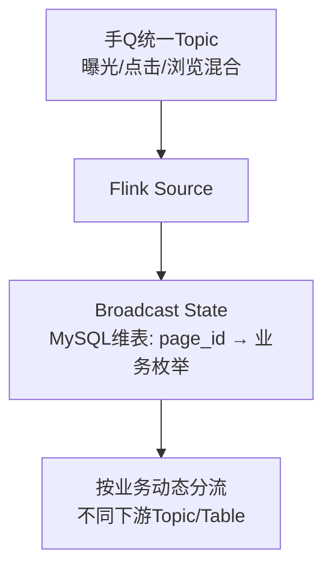

**一、面试官真正想考什么？**

不是问项目列表，而是考：
- 你对"复杂"的定义是否成熟（不是单纯数据量大，而是架构决策难度）
- 你是否真正Owner过一个有技术深度的项目
- 你能否结构化表达复杂问题

**二、回答思路**

选一个项目 → 说清楚为什么复杂 → 你如何解决 → 最终效果

**三、参考答案（面试标准版）**

> 控制在2分钟

最复杂的是QQ频道数仓建设项目。复杂在三个层面：

**第一，数据复杂度高。** 频道数据不是独立日志，而是嵌套在手Q公共日志体系里。需要从全量手Q日志中，按业务标识拆分出频道数据，光数据接入层就涉及动态分流的架构设计。

**第二，业务变化快。** 社交业务不像电商有稳定的交易模型，频道的页面、功能、运营活动变化非常频繁。维度变化快意味着建模不能用传统的宽表退化思路，需要保持事实和维度分离，把关联放到DWS层完成。

**第三，治理难度大。** 随着业务迭代，历史表资产不断累积。低版本手Q下线、旧页面废弃后，对应的表和任务成为僵尸资产。需要通过血缘分析和访问记录判断使用情况，推动下线。

**我的解决思路：**
- 数据接入层：Flink广播流动态分流，维护MySQL维表做页面→业务映射，新增业务只改配置不改代码
- 建模层：DWD严格标准化，DWS沉淀公共指标，控制变化传播范围
- 治理层：增量严格治理 + 存量兼容治理，通过数据地图推动资产健康度提升

**四、技术知识补充**

Flink广播流分流方案：

优势：新增页面或业务变化 → 只改维表，不需要重新发布Flink任务。

**五、追问预判**

1. **追问：Flink广播流具体怎么实现？**
   → 用BroadcastProcessFunction，维表变更通过CDC推到Kafka，Flink消费后更新BroadcastState，主流数据匹配时从State读最新映射。

2. **追问：增量治理和存量兼容具体怎么做？**
   → 新建表必须走规范（命名/分区/字段标准），老表不强改（因为下游依赖太多），通过血缘+影响评估逐步迁移。

3. **追问：项目最终效果如何量化？**
   → {需要补充：具体数据，如资产复用率提升比例、任务数减少比例}

**六、常见错误/踩坑提醒**

- ❌ 「这个项目数据量很大所以很复杂」 → ✅ 从架构决策难度和业务变化维度说明复杂性
- ❌ 罗列做了什么而不说为什么难 → ✅ 先定义复杂在哪，再说怎么解决

**七、记忆版（30秒压缩）**

> QQ频道数仓项目，复杂在三点：数据嵌套在手Q日志需动态分流、社交业务变化快不能传统退化建模、历史资产治理难。方案：Flink广播流动态分流 + DWD/DWS分离控制变化 + 增量严格/存量兼容的治理策略。

---
